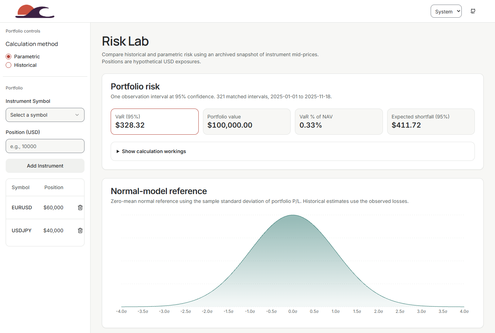
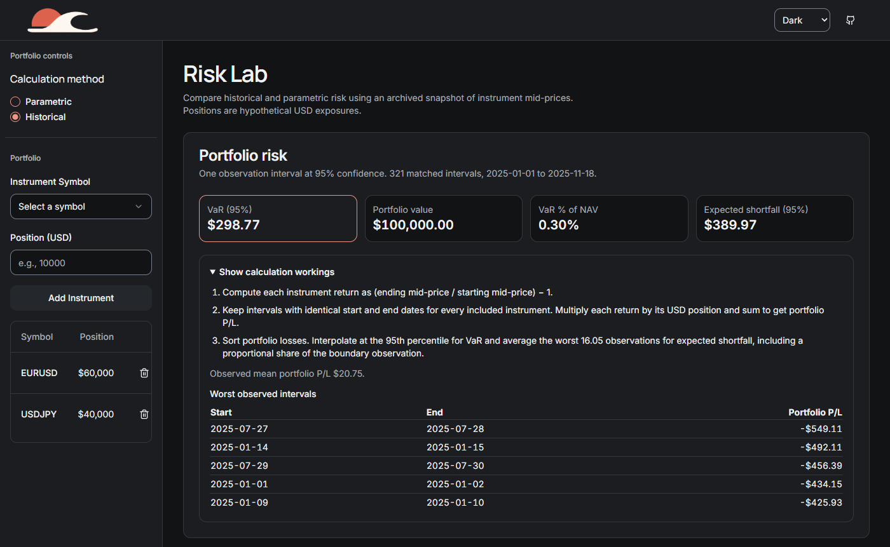

# Risk Lab

An interactive portfolio demo for value at risk per matched observation interval (VaR) at 95% confidence. Compare parametric and historical estimates, change the sample portfolio, and read an explanation of the results in the browser.

The USD positions are hypothetical. The app calculates returns from the original archived instrument mid-prices. The exported app runs without a server or API key. See the [methodology](docs/risk-methodology.md) and [reproducible notebook](docs/varprices.ipynb).

[Open Risk Lab](https://imchuwy.github.io/app-risk-var/)

## Screenshots

**Parametric VaR** for the sample portfolio, alongside expected shortfall and the normal-model reference curve.

**Historical VaR** with the calculation expanded to show the worst observed intervals.

## Run locally

- Install the locked dependencies with `npm ci`.
- Run `npm run dev` and open the address printed in the terminal.
- Run `npm run build` to export a static site to `out/`. Set `NEXT_PUBLIC_BASE_PATH` to `/app-risk-var` when building for the GitHub Pages project URL.
